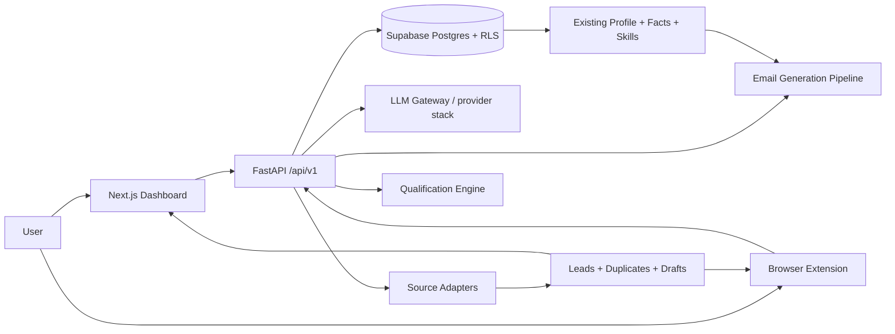

# Ansly Leads: Product Requirements Document and Technical Design Specification

Status: Documentation-only. This file defines a future implementation plan for Ansly Leads and intentionally does not modify any existing application code, database, or runtime behavior.

## Document purpose

This document is written to be handed directly to OpenAI Codex or another implementation agent. It is grounded in the current Ansly codebase and explicitly separates:

- verified existing behavior,
- proposed new feature behavior,
- required integration points,
- assumptions,
- unresolved decisions.

No implementation work is performed in this document. The feature is intentionally scoped to discovery, qualification, organization, and outreach preparation, not CRM automation or platform scraping that violates terms of service.

---

## 1. Executive Summary

Ansly Leads is an opportunity discovery and outreach-preparation assistant that fits inside the existing Ansly architecture. The product is designed to help users discover posts, profiles, opportunities, and outreach-worthy leads that match one or more user-defined targeting profiles. It should surface relevant opportunities, extract the most useful information available, deduplicate and classify them, and help the user prepare personalized outreach drafts.

The current Ansly codebase already contains the essential building blocks for this feature:

- a Next.js authenticated dashboard with a sidebar and routed app shell,
- a browser extension built with WXT + React and per-site content scripts,
- a FastAPI LLM service with JWT-based auth and structured answer generation,
- a Supabase-backed data model with RLS, profile storage, and profile facts,
- shared TypeScript contracts between the web app, extension, and backend,
- a retrieval and grounding pattern for user knowledge, experience, skills, and facts.

The new feature should reuse these systems rather than creating a parallel system.

The feature is intentionally scoped to:

1. collecting candidate opportunities from supported sources,
2. qualifying them against a targeting profile,
3. storing them as leads with provenance and metadata,
4. deduplicating repeated discoveries,
5. extracting contact details when explicitly available,
6. generating personalized email drafts from the user's verified profile and project background,
7. enabling manual sending from the user's email client.

It does not include autonomous outreach, scraping of protected platforms, or sending emails on the user's behalf.

---

## 2. Product Vision

Ansly Leads should act as a focused, human-in-the-loop opportunity discovery assistant. It should help a user find professional opportunities that are already visible in ordinary social posts, company updates, founder posts, and recruiter updates, but which the user may otherwise miss.

The product vision is not a full CRM. It is a lightweight, privacy-conscious lead workflow that helps users:

- discover opportunities matching their goals,
- save the relevant leads,
- avoid duplicate records,
- prepare outreach quickly,
- use their profile data to personalize messages.

The system should be configurable for multiple user goals and future professions, not locked into software-only hiring posts.

---

## 3. Problem Statement

Current job-search tooling focuses on job listings and forms, but a large amount of opportunity discovery happens in public social content, founder posts, startup channels, recruiter announcements, and business-owner requests.

Users need a way to:

- tell the system what kinds of opportunities they want,
- collect promising posts without manual copy-and-paste,
- quickly decide whether a post is relevant,
- save qualified opportunities as leads,
- prepare personalized outreach using verified profile knowledge,
- avoid duplicates and noise.

The existing Ansly product is grounded in truthfulness and user-controlled generation. Leads should preserve that principle: it should never invent missing data, never infer details not present in the post, and never generate outreach on the basis of unsupported claims.

---

## 4. Goals and Non-Goals

### Goals

- Create a configurable targeting profile system for opportunity discovery.
- Support initial discovery from a supported, compliant source adapter, with LinkedIn as the first target.
- Qualify post intent using deterministic and AI-assisted routing.
- Store leads with source provenance, metadata, and status.
- Deduplicate repeated or similar content.
- Provide a minimal dashboard for lead review and management.
- Generate individualized email drafts using the user's profile and project background.
- Allow users to manually copy and send emails.
- Support a clean UI integrated into the existing dashboard.

### Non-Goals for initial v1

- Automatic email sending.
- Automated LinkedIn messaging or direct outreach.
- Gmail inbox monitoring.
- CRM stages, deal management, forecast, or pipeline analytics.
- Reply tracking and automation.
- Automated job application submission.
- Unauthorized scraping or anti-bot circumvention.
- A multi-platform social-media scraping engine in v1.

### Product principles

The feature should be governed by a small set of explicit product principles:

- groundedness over volume: only save and present information supported by the source content or the user’s verified profile;
- transparency over automation: every lead must retain source provenance, collection context, and qualification rationale;
- user control over outreach: the app may draft and prepare messages but must never send them by itself;
- relevance is not contactability: a lead may be highly relevant without a direct email address or application route;
- review for uncertainty: ambiguous, incomplete, or policy-sensitive content should be placed in a review state rather than auto-classified.

### MVP definition

The initial release should be considered successful only when the system can do all of the following in a compliant, user-controlled flow:

1. create at least one targeting profile and switch between profiles,
2. collect candidate opportunities from a supported source in a user-initiated workflow,
3. qualify each candidate as relevant, irrelevant, duplicate, or needs review,
4. store leads with source provenance and collection metadata,
5. deduplicate repeated or near-duplicate content,
6. show leads in a dashboard with filters, search, and status,
7. generate a personalized email draft from the user’s verified profile when a usable contact path exists,
8. preserve edited drafts and require explicit confirmation before overwriting them,
9. keep all data scoped to the authenticated user via the same RLS and auth model already used in Ansly.

These criteria create a minimum viable working loop for lead discovery and outreach preparation without expanding into CRM automation or unsanctioned scraping.

### Delivery workstreams

The feature should be implemented as a small number of concrete workstreams rather than as one monolithic build. This keeps the product manageable and creates clear handoff points for engineering, product review, and QA.

#### Workstream A: targeting profiles and profile ownership

Scope:
- create and persist user-owned targeting profiles,
- support active-profile switching,
- preserve historical profile context on old leads,
- provide CRUD UX in dashboard and extension.

Dependencies:
- backend auth and RLS,
- Supabase tables for targeting profiles and snapshot data,
- shared types for profile payloads.

Definition of done:
- user can create, edit, duplicate, and switch profiles,
- leads retain the original targeting profile context,
- profile storage remains scoped to the authenticated user.

#### Workstream B: collection sessions and source adapters

Scope:
- add session orchestration for collection runs,
- define source adapter contract,
- support the first compliant collection source,
- surface collection status and results summary.

Dependencies:
- source adapter registry,
- collection session table,
- structured result schema,
- extension-to-backend messaging.

Definition of done:
- user can run a collection session from a supported source,
- result summary includes saved, duplicate, relevant, irrelevant, and needs-review counts,
- unsupported sources fail with explicit guidance instead of silent failure.

#### Workstream C: qualification, dedupe, and lead persistence

Scope:
- classify relevance and intent,
- normalize content into a standard lead model,
- deduplicate exact and near-duplicate leads,
- persist source provenance and metadata.

Dependencies:
- qualification service,
- duplicate-detection utility,
- lead schema and database model,
- provenance fields for original URLs and timestamps.

Definition of done:
- a candidate can be classified as relevant, irrelevant, duplicate, or needs review,
- duplicate records are skipped or flagged consistently,
- each saved lead keeps original source context and collection evidence.

#### Workstream D: lead review and dashboard UX

Scope:
- lead list and detail page,
- status filters, searches, and bulk actions,
- per-lead detail views and AI qualification rationale,
- lead status transitions and audit history.

Dependencies:
- dashboard navigation,
- shared UI primitives,
- lead API routes,
- status and event table design.

Definition of done:
- a user can review, filter, search, and manage leads without leaving the dashboard,
- lead details show source information, reasoning, and contact metadata,
- status updates are explicit and auditable.

#### Workstream E: contact extraction and email draft generation

Scope:
- explicit contact extraction only,
- contactability classification,
- draft generation from profile-grounded context,
- edit/copy/regenerate patterns for user-controlled outreach.

Dependencies:
- existing profile retrieval and grounding system,
- shared email-generation service,
- `lead_drafts` persistence and draft protection logic.

Definition of done:
- only explicit contact info is stored,
- drafts are generated for eligible leads only,
- edited drafts are protected from silent overwrite,
- generation remains manual and user-controlled.

#### Workstream F: compliance, privacy, and testing

Scope:
- confirm source compliance and permissions,
- enforce RLS and user scoping,
- protect sensitive contact info,
- cover regression and acceptance tests.

Dependencies:
- backend validation and permissions,
- security review of data flow,
- QA scenarios covering duplicates, email generation, and manual review.

Definition of done:
- no unsupported scraping or bypass behavior,
- data is scoped per user,
- manual-review and error states are tested and documented.

---

## 5. Target Users and Use Cases

### Primary users

- job seekers looking for relevant hiring posts,
- freelancers seeking contract or project work,
- founders or business owners seeking developers or consultants,
- recruiters or hiring managers seeking talent,
- professionals with multiple goals whose interests vary by profile.

### Primary use cases

- a user wants remote backend or full-stack roles,
- a user wants freelance app builds or website work,
- a user wants startup opportunities or consulting work,
- a user wants to review and save relevant posts without manual copy-paste,
- a user wants to generate a personalized email using evidence from their actual profile.

---

## 6. Existing Ansly Architecture Analysis

This section describes what is already verified in the repository and what this feature must reuse.

### 6.1 Web application

Verified architecture:

- authenticated app routes live under [web/src/app/(app)](../web/src/app/(app))
- the main app shell is [web/src/components/app-shell.tsx](../web/src/components/app-shell.tsx)
- the authenticated layout is [web/src/app/(app)/layout.tsx](../web/src/app/(app)/layout.tsx)
- the dashboard lives at [web/src/app/(app)/dashboard/page.tsx](../web/src/app/(app)/dashboard/page.tsx)

The actual web app is a Next.js + React authenticated dashboard with groups such as:

- Dashboard,
- Get Ansly ready,
- Profile,
- Resume,
- Workspace,
- Settings.

This is the right integration point for a new Leads section in the workspace or main navigation.

### 6.2 Design system and shared UI

The codebase already contains reusable UI primitives under [web/src/components/ui](../web/src/components/ui) and shared tokens under [packages/design](../packages/design).

The design pattern is:

- card-based dashboard items,
- consistent button styles,
- page headers,
- stat blocks,
- status chips and neutral/accent visual treatment,
- data-table or list patterns.

This feature should follow the same conventions rather than invent a separate UI style.

### 6.3 Browser extension architecture

Verified architecture:

- extension uses WXT + React: [extension/README.md](../extension/README.md)
- site enablement logic is in [extension/src/lib/sites.ts](../extension/src/lib/sites.ts)
- background session and API logic are in [extension/src/entrypoints/background.ts](../extension/src/entrypoints/background.ts)
- shared communication contracts are in [packages/types](../packages/types)

This confirms:

- the extension is not a fully global automation environment,
- it operates on user-enabled domains only,
- it performs content-scripting only when permitted,
- it sends requests through accurately scoped background logic.

This is the correct architecture for a lead collection feature, but it must remain compliant with platform terms and user permissions.

### 6.4 API and auth architecture

Verified flow:

- the API runs as a FastAPI app in [llm/src/app/main.py](../llm/src/app/main.py)
- versioned routers are mounted in [llm/src/app/api/router.py](../llm/src/app/api/router.py)
- answer generation uses structured schemas in [llm/src/app/schemas/answers.py](../llm/src/app/schemas/answers.py)
- the web app calls the API with the active user JWT in [web/src/lib/api.ts](../web/src/lib/api.ts)

Ansly has an established pattern:

- Supabase Auth for user identity,
- Supabase JWT for backend authorization,
- user-owned row-level security for profile data and stored artifacts,
- per-user profile retrieval.

This architecture is the correct pattern for leads and lead drafts.

### 6.5 Database and RLS model

Verified schema in [supabase/migrations/20261002000000_profile_schema.sql](../supabase/migrations/20261002000000_profile_schema.sql) and related migrations.

Current tables include:

- profiles,
- experiences,
- projects,
- skills,
- education,
- achievements,
- profile_facts,
- saved_answers,
- usage_events,
- candidate_evidence.

RLS is implemented with user-bound policies. The new lead feature should follow the same user-scoped pattern and not introduce cross-user access.

### 6.6 AI knowledge and retrieval

Verified retrieval and knowledge patterns include:

- profile sections,
- structured facts,
- saved answers,
- candidate_evidence semantic retrieval,
- LLM usage accounting,
- context-aware generation.

The relevant evidence files are:

- [supabase/migrations/20261003000000_profile_facts.sql](../supabase/migrations/20261003000000_profile_facts.sql)
- [supabase/migrations/20261011000000_candidate_evidence.sql](../supabase/migrations/20261011000000_candidate_evidence.sql)
- [llm/src/app/answers/profile_context.py](../llm/src/app/answers/profile_context.py)
- [llm/src/app/answers/engine.py](../llm/src/app/answers/engine.py)

This is the exact system that should power personalized email generation in Leads.

### 6.7 Existing functionality to reuse

The following should be reused directly:

- web dashboard shell and route structure,
- shared UI conventions and component library,
- Supabase Auth + JWT-based backend auth,
- RLS-first user data isolation,
- answer-generation service and LLM gateway,
- existing profile facts and semantic knowledge retrieval,
- extension background/session architecture,
- site enablement and content-script registration flow,
- shared TypeScript API type contracts.

### 6.8 Existing functionality not to be reused for a different purpose

This feature must not reuse or repurpose unrelated features such as:

- resume-tailoring job analysis pipeline as a source of social-post opportunity discovery,
- application answer generation as a general-purpose lead classifier without additional structured validation,
- memory and fact storage as a replacement for source-provenance capture.

---

## 7. Proposed Architecture

### 7.1 High-level concept

The new architecture should add a new Leads workflow on top of the current system rather than replacing existing flows.

Proposed components:

- `TargetingProfiles` entity (new)
- `lead_collection_sessions` (new)
- `leads` (new)
- `lead_drafts` (new)
- `lead_events` or status history (new)
- `source_adapters` layer (new)
- `qualification_engine` service (new)
- `duplicate_detection_service` (new)
- `email_generation_service` (new)
- `lead_dashboard_page` (new) under the authenticated app
- `Leads` nav item in the app shell
- extension collection UI and collection flow (new)

Important: these are proposed future implementation structures, not already-existing code.

### 7.2 High-level architecture diagram



### 7.3 Source adapter pattern

The collection architecture must be source-agnostic at the service layer.

Suggested adapter contract (proposed):

- `platform` identifier,
- `supported()` check,
- `collect_candidates()` for candidate posts or opportunities,
- `normalize_candidate()` for shared lead schema,
- `extract_contactability()` for handling explicit contact info,
- `collect_review_summary()` for session outputs.

This is necessary because LinkedIn is the initial platform, but the system should not be hard-coded to one provider.

---

## 8. Targeting Profiles

This is a core product feature and a new user-defined configuration system.

### 8.1 Purpose

A targeting profile defines what kinds of opportunities the user wants to discover. The system supports multiple profiles and profile switching.

### 8.2 Requirements

Users must be able to:

- create profiles,
- edit profiles,
- duplicate profiles,
- delete profiles,
- activate a profile,
- switch the active profile,
- give the profile a name and description,
- define roles and professions,
- define search keywords and exclusion phrase filters,
- apply location, remote, hybrid, and onsite preferences,
- define employment type and opportunity type,
- set minimum requirements and AI qualification preferences.

### 8.3 Proposed profile fields

A profile should contain fields such as:

- `id`
- `user_id`
- `name`
- `description`
- `is_active`
- `created_at`
- `updated_at`
- `target_roles[]`
- `keywords[]`
- `excluded_keywords[]`
- `industries[]`
- `locations[]`
- `remote_preferences`
- `employment_types[]`
- `opportunity_types[]`
- `minimum_requirements`
- `contactability_preferences`
- `qualification_preferences`
- `is_deleted` (soft delete if implemented)

Required vs optional fields must be defined in the implementation phase. Recommended defaults:

- name: required,
- description: optional,
- target roles: required at least one entry,
- keywords: optional but recommended,
- excluded keywords: optional,
- industries: optional,
- locations: optional,
- remote preferences: required or default to `any`,
- opportunity types: required or default to `any`,
- employment types: optional,
- minimum requirements: optional,
- contactability preferences: optional,
- AI qualification preferences: optional.

### 8.4 Profile switching and history

The app must support a clean profile switcher in the extension and in the dashboard. Each collection session must record the active targeting profile at the time the session started.

Historical leads must preserve the targeting context as they were first collected. If a profile is later edited or deleted, previous leads must remain associated with their original snapshot or equivalent immutable context.

### 8.5 Future proofing

The profile system should not be hard-coded to software roles or hiring-only posts. It should support future categories such as:

- freelance projects,
- consulting,
- service requests,
- collaborations,
- temporary or contract work,
- non-software opportunities,
- industries beyond tech.

This should be handled with generic profile field names and a flexible opportunity taxonomy rather than a hard-coded software-only configuration.

---

## 9. Opportunity Discovery

### 9.1 Source support model

LinkedIn is the first intended source, but the architecture must not assume LinkedIn is the only supported source. The system should support multiple source adapters behind a shared lead schema.

### 9.2 Intended user journey

The intended extension workflow is:

1. user visits LinkedIn,
2. searches for posts such as “Hiring Remote Developers”,
3. opens posts, selects latest, and scrolls,
4. opens the Ansly extension,
5. selects a targeting profile,
6. clicks Collect Leads,
7. the extension processes available candidate posts,
8. summary results are shown,
9. saved leads appear in the Ansly dashboard.

Important: this workflow must be evaluated against platform permissions and terms.

### 9.3 Compliance requirement: LinkedIn restrictions

This feature must not create production behavior that:

- bypasses LinkedIn rate limits,
- uses hidden automation,
- scrapes DOM content in violation of platform restrictions,
- circumvents anti-bot protections,
- accesses private data without authorization.

Implementation must document the difference between:

- technically possible,
- officially supported by LinkedIn,
- user-authorized and compliant.

The specification must prefer an officially permitted mechanism whenever available. If LinkedIn does not provide a compliant data-collection path for the required workflow, the feature should fall back to a clearly documented, explicit user-authorized import or supported adapter pattern rather than building an unauthorized scraper.

### 9.4 Supported vs unsupported collection modes

The implementation should support the following patterns:

- user-authenticated import or export from an approved provider,
- user-selected content capture with explicit consent,
- browser extension action against content the user intentionally opened and is viewing,
- future adapter for other sources with similar permissions.

It should not support the following in v1:

- hidden pages, automated scrolling and scraping without the user’s explicit action,
- unauthorized harvesting of profile data,
- background collection across unrelated tabs,
- content exfiltration from protected pages.

---

## 10. Browser Extension Requirements

### 10.1 Existing extension behavior to preserve

The extension already supports:

- per-site permissions,
- content scripts registered only for user-enabled sites,
- a popup UI,
- site enablement and management,
- background service worker communication,
- data fetching through secure API calls,
- user session handling.

These remain the baseline for Leads.

### 10.2 Proposed Leads extension flow

The extension needs a new Leads UI state with these elements:

- platform indicator,
- selected targeting profile,
- supported/not supported source state,
- candidate count when available,
- collection summary,
- progress and processing messages,
- result summary,
- save and review actions.

### 10.3 Example messages from the extension

The extension should show clear completion states:

- Completed,
- Partially completed,
- Failed,
- No candidates found,
- Duplicate found,
- Unsupported platform,
- Invalid or expired session.

Example summary:

- 20 posts reviewed,
- 10 relevant opportunities identified,
- 8 new leads saved,
- 2 duplicates skipped.

The UI must not claim that every post was processed when only a subset was accessible.

### 10.4 Collect Leads button behavior

When the user clicks Collect Leads:

1. validate session and platform support,
2. ensure a targeting profile is active,
3. fetch candidate posts available to the adapter,
4. process each candidate through filtering and AI qualification,
5. notify the user of progress,
6. show a final summary,
7. save new leads to the backend,
8. display duplicate and error counts.

Loading states:

- disabled while processing,
- spinner or progress label,
- repeated click prevention,
- safe failure and retry behavior.

---

## 11. AI Qualification Engine

This is the central intelligence of Ansly Leads.

### 11.1 Classification categories

Each candidate should be classified across several dimensions:

- relevance,
- opportunity type,
- role fit,
- skill match,
- requirement extraction,
- contactability,
- exclusion match,
- confidence,
- explanation.

A post should not be treated as merely a keyword match. The system must attempt to understand the actual intent of the post.

### 11.2 Example relevant vs irrelevant content

Relevant examples:

- “We are hiring a remote Full Stack Developer.”
- “Looking for someone to build an ecommerce website.”
- “Need a Next.js developer for an MVP.”
- “Our startup is looking for a software engineer.”

Irrelevant examples:

- “Developers are changing the world.”
- “What is your favorite programming language?”
- “Comment INTERESTED to learn about our services.”
- “Looking for a graphic designer” when the user's profile targets software roles.

Uncertain cases:

- “DM me if interested.”
- “We need a developer.”
- incomplete posts,
- ambiguous payment terms,
- posts where intent is weak.

These should be classified appropriately rather than automatically discarded.

### 11.3 Qualification pipeline

The pipeline should be cost-efficient and deterministic:

1. normalize candidate content,
2. apply deterministic, rule-based filters,
3. find candidate posts with potential relevance,
4. send plausible candidates to AI for semantic classification,
5. validate structured output,
6. extract contacts and requirements,
7. apply exclusion rules,
8. deduplicate,
9. save only qualified leads.

This avoids AI calls for obviously irrelevant posts.

### 11.4 Output schema (proposed)

```json
{
  "is_relevant": true,
  "opportunity_type": "freelance_project",
  "matched_roles": ["Full Stack Developer"],
  "matched_skills": ["Next.js", "PostgreSQL"],
  "remote": true,
  "contactability": "email_available",
  "emails": ["founder@example.com"],
  "requirements": ["Next.js", "PostgreSQL", "Payment integration"],
  "reason": "The author is actively looking for a developer to build a web application.",
  "confidence": 0.96
}
```

This schema is illustrative and should be formalized in implementation with strict validation.

### 11.5 Critical distinction: Relevance vs Contactability

These must remain separate fields. A lead can be highly relevant while still having only LinkedIn DM or no email. The system must not reject relevant opportunities simply because a direct email is unavailable.

### 11.6 AI failure and uncertainty handling

The feature must define fallback behavior when:

- AI output is incomplete,
- AI output is malformed,
- the provider is unavailable,
- the content is ambiguous,
- the model refuses a classification.

Suggested handling:

- return a “needs review” state,
- keep the candidate out of auto-saved qualified leads,
- log the failure reason,
- allow a human re-review.

---

## 12. Contact Information Extraction

### 12.1 Requirements

The system must extract contact details only when they are explicitly present in the available content.

Potential fields:

- author name,
- author profile URL,
- email addresses,
- phone numbers when explicitly published and relevant,
- application links,
- company website,
- contact instructions.

The system must never invent or guess contact details.

### 12.2 Classification types

Contactability should be modeled as a distinct classification, for example:

- email_available,
- application_link_available,
- dm_only,
- contact_form_available,
- no_contact_information_found,
- unknown.

### 12.3 Validation and normalization rules

Implementation should validate:

- email syntax,
- URL structure,
- canonicalization of profile URLs,
- duplicate removal after normalization,
- source-specific restrictions.

It must never construct a plausible email by combining the author’s name with a company domain.

---

## 13. Lead Management Dashboard

### 13.1 Navigation integration

A new item titled Leads must be added to the dashboard navigation using the same pattern as the existing app shell in [web/src/components/app-shell.tsx](../web/src/components/app-shell.tsx).

Recommended placement: in the Workspace group, near saved answers and extension.

### 13.2 Dashboard overview

The Leads dashboard should show:

- total leads,
- new leads,
- contacted leads,
- leads with email addresses.

### 13.3 Lead listing requirements

The list should include:

- search,
- status filters,
- platform filters,
- opportunity type filters,
- contactability filters,
- targeting profile filters,
- date filters,
- sorting.

Each lead row should display:

- author name,
- author profile link,
- short opportunity description,
- source platform,
- original post link,
- publication date,
- contactability,
- email when available,
- status.

### 13.4 Lead actions

Users should be able to:

- open lead details,
- open original post,
- open author profile,
- copy email,
- generate email,
- mark as Contacted,
- delete lead.

### 13.5 Lead details

The lead details view should include:

- full original post text,
- author details,
- profile URL,
- original post URL,
- email and other contact details,
- extracted requirements,
- matched skills,
- matched roles,
- opportunity type,
- AI qualification reason,
- confidence,
- targeting profile,
- publication timestamp,
- collection timestamp,
- current status.

The implementation must clearly distinguish publication time vs collection time.

---

## 14. Lead Details

Lead details should not be an afterthought; they are core usability. The details page must allow a user to review the original post, understand why it was classified, see how it was deduplicated, and what generated outreach is possible.

The lead details screen should include:

- original source content,
- normalized content,
- qualification metadata,
- extracted requirements,
- contact info,
- profile context snapshot,
- source route and target profile,
- associated drafts,
- status.

---

## 15. Lead Selection and Bulk Actions

### 15.1 Selection behavior

Users should be able to:

- select one lead,
- select multiple leads,
- select all leads on the current page,
- clear selection,
- view selection count,
- perform bulk actions.

Bulk actions include:

- Generate email drafts,
- Mark as Contacted,
- Delete selected leads.

### 15.2 Selection semantics

The implementation must clearly distinguish:

- current page selection,
- filter-selected view,
- all-results selection.

Selection behavior on filter or page changes must be explicitly defined in the implementation. Recommended behavior:

- selection is cleared on page navigation,
- selection is preserved across a simple filter change only while the result set is still the same page,
- bulk actions run on the current selected set only,
- selection is re-evaluated after a reload.

This must be specified to avoid hidden state surprises.

---

## 16. Duplicate Detection

### 16.1 Goal

Repeated collection must not create unnecessary duplicate leads.

### 16.2 Deduplication levels

#### Exact matching

Exact dedupe should include:

- platform,
- source post ID when available,
- canonical post URL,
- any stable source identifier.

#### Similarity matching

Similarity dedupe should include:

- normalized author profile URL,
- email address,
- normalized post text,
- text similarity,
- opportunity similarity,
- publication date.

### 16.3 Expected behavior

- same post collected again => skip
- same URL with different tracking parameters => skip
- same author publishes a different job => save separately
- same email for a different freelance project => save separately
- similar post with uncertain identity => flag for review

Never automatically merge unrelated opportunities simply because they share an author or domain.

### 16.4 Proposed DB and service responsibilities

Implementation should define:

- canonical URL normalization service,
- dedupe rules in a backend service,
- unique index on canonical source identity,
- partial indexes or hash columns for fast lookup,
- review buckets for uncertain duplicates,
- reporting in the collection summary.

---

## 17. Collection Sessions and History

Every collection operation should create a session record.

### 17.1 Session fields (proposed)

- user_id,
- source_platform,
- targeting_profile_id,
- started_at,
- completed_at,
- status,
- total_candidates_reviewed,
- relevant_candidates,
- irrelevant_candidates,
- duplicates_skipped,
- new_leads_saved,
- needs_review_count,
- error_count,
- summary_json.

### 17.2 Statuses

- pending,
- processing,
- completed,
- partially_completed,
- failed.

Users should be able to view prior collection sessions in a small history panel or page.

### 17.3 Collection summary

The summary should clearly describe:

- what was reviewed,
- what was found,
- what was saved,
- what was skipped,
- what needs manual review.

---

## 18. Lead Status Management

### 18.1 Supported statuses

Initial support should be limited to:

- New,
- Contacted.

### 18.2 Status behavior

- generating email does not set Contacted,
- copying an email does not set Contacted,
- only an explicit user action changes status,
- status changes should be timestamped,
- bulk status updates should be supported,
- there should be an undo path where appropriate.

No CRM-like stages should be introduced in v1.

---

## 19. Personalized Email Generation

This is a key feature and must reuse the existing Ansly knowledge architecture rather than creating a separate professional-profile system.

### 19.1 Reuse existing profile knowledge

The email generation pipeline should use:

- experience,
- projects,
- skills,
- education,
- accomplishments,
- profile facts,
- saved answers.

This is exactly where the current Ansly retrieval model is strongest.

### 19.2 Email generation workflows

#### Workflow A: one lead

When the user opens a lead, there should be a Generate Email action.

It must:

1. confirm email availability,
2. load the lead data,
3. retrieve relevant user profile context,
4. generate personalized subject and body,
5. save the draft,
6. show the draft for review and editing.

#### Workflow B: selected leads

When selecting multiple leads, there should be a Generate Emails bulk action. This must generate a separate draft per lead, not one combined email.

Each draft must have:

- one lead,
- one recipient,
- one subject,
- one body,
- its own editability,
- its own copy action.

#### Workflow C: all eligible leads

The system should also support a clearly identified Generate emails for all eligible leads action with confirmation.

This must require explicit confirmation and must not be triggered accidentally from a normal single-lead Generate Email action.

### 19.3 Email eligibility rules

The system should prioritize leads with explicit email addresses. Leads without email addresses remain in the system but should not receive generated email drafts that would appear deceptive.

The implementation must define behavior for:

- no email available,
- existing draft,
- edited draft,
- missing post information,
- insufficient context,
- already-contacted leads.

### 19.4 Existing draft behavior

If a draft already exists:

- offer to open it,
- offer to regenerate,
- show a warning before overwriting user-edited content,
- never silently overwrite an edited draft.

### 19.5 Bulk generation progress

During bulk generation, show:

- total requested,
- completed,
- skipped,
- failed,
- remaining.

At completion, summary should state:

- successfully generated,
- skipped,
- failed,
- any manual edits preserved.

The system must allow retry of failed items without regenerating successful or manually edited drafts.

---

## 20. Email Draft Management

Each draft should be a first-class object.

Draft metadata should include:

- draft id,
- lead id,
- user id,
- recipient email,
- subject,
- body,
- created_at,
- updated_at,
- status (draft, edited, generated, failed),
- source generation metadata.

Users should be able to:

- edit subject,
- edit body,
- save changes manually or automatically based on existing patterns,
- copy full email,
- regenerate,
- delete draft,
- reopen an existing draft.

No automatic sending should be implemented in v1.

---

## 21. Frontend Architecture

### 21.1 Core frontend surfaces

Proposed new frontend surfaces:

- Leads dashboard page,
- lead details page,
- lead filters and search panel,
- collection summary modal,
- profile selector in extension popup,
- collection results list,
- bulk action toolbar,
- email draft drawer or side panel,
- confirmation dialogs for risky actions.

### 21.2 Existing components to reuse

- [web/src/components/app-shell.tsx](../web/src/components/app-shell.tsx) for navigation and layout,
- [web/src/components/ui](../web/src/components/ui) for cards, buttons, copy actions, forms, and page sections,
- [web/src/components/dialog.tsx](../web/src/components/dialog.tsx) for confirmations,
- [web/src/components/tag-input.tsx](../web/src/components/tag-input.tsx) for chips and tags,
- [web/src/components/enabled-sites.tsx](../web/src/components/enabled-sites.tsx) and extension popups for collection control patterns.

### 21.3 Standard interactive patterns

The Leads UI should define explicit states for:

- empty,
- loading,
- progressing,
- success,
- partial success,
- error,
- no search results,
- no drafts,
- duplicate detected,
- unsupported source.

---

## 22. Backend Architecture

### 22.1 Proposed backend responsibilities

The backend should handle:

- authentication and authorization,
- target profile CRUD,
- collection session orchestration,
- source adapter coordination,
- qualification service calls,
- deduplication checks,
- lead persistence,
- lead and draft retrieval,
- email generation,
- rate limiting,
- analytics and logging.

### 22.2 Proposed services

- `TargetingProfileService`
- `LeadCollectionService`
- `LeadQualificationService`
- `SourceAdapterRegistry`
- `DuplicateDetectionService`
- `ContactExtractionService`
- `LeadDraftService`
- `LeadEmailGenerationService`

These services are proposed and must be implemented as part of the eventual feature work. They should stay within the existing FastAPI architecture and reuse current Supabase + LLM patterns.

---

## 23. Database Schema

The existing codebase already has a strong user-owned data model. Leads should integrate into that structure without creating a second, disconnected identity system.

### 23.1 Existing tables relevant to Leads

- `profiles`
- `skills`
- `experiences`
- `projects`
- `education`
- `achievements`
- `profile_facts`
- `saved_answers`
- `usage_events`
- `candidate_evidence`

These are used as the user knowledge base and should be reused for lead personalization.

### 23.2 Proposed new tables

The implementation should add proposed tables such as:

- `targeting_profiles`
- `lead_collection_sessions`
- `leads`
- `lead_status_events`
- `lead_drafts`
- `lead_source_snapshots`
- `lead_duplicates`
- `lead_contact_info`

Each table must be user-scoped and protected with RLS. These are proposed future structures, not current repo tables.

### 23.3 Relationship expectations

The lead system should support:

- one user to many targeting profiles,
- one user to many collection sessions,
- one targeting profile to many session runs,
- one lead to many drafts,
- one lead to many status events,
- one lead to many source snapshots,
- one user to many leads.

### 23.4 Data retention and auditability

Each lead should preserve:

- source platform,
- original post identifier or canonical URL,
- collection timestamp,
- publication timestamp,
- targeting profile snapshot,
- collection session context,
- qualification metadata,
- dedupe decision reasons.

---

## 24. API Specifications

The implementation should add new endpoints under the existing FastAPI structure in [llm/src/app/api/router.py](../llm/src/app/api/router.py).

Proposed route families:

- `/api/v1/targeting-profiles`
- `/api/v1/leads`
- `/api/v1/leads/:id/drafts`
- `/api/v1/leads/:id/status`
- `/api/v1/leads/collections`
- `/api/v1/leads/collection-sessions`
- `/api/v1/leads/email/generate`
- `/api/v1/leads/email/bulk`

These are not currently present in the repo and must be treated as proposed future routes.

### 24.1 Proposed request and response patterns

- GET list of profiles, leads, sessions, drafts,
- POST create profile, create lead, generate draft,
- PATCH edit profile, update lead status,
- DELETE delete profile or lead,
- POST batch generate emails,
- GET lead details with embedded metadata.

All responses should include the same status/error semantics used elsewhere in the repo, with a consistent failure response pattern based on the established FastAPI and TypeScript API contracts.

---

## 25. AI Prompt Design

The implementation should reuse the existing LLM gateway and structured generation patterns.

### 25.1 Prompt categories

1. opportunity classification,
2. requirements extraction,
3. contactability classification,
4. personalized email generation.

### 25.2 Policy constraints

The prompt must be built with strong guardrails:

- never invent contact details,
- never claim experience or skills not in the user's data,
- treat post content as untrusted,
- allow uncertain classification instead of guessing,
- keep system-level instructions above arbitrary content,
- avoid prompt-injection manipulation from third-party content.

### 25.3 Example prompts

The eventual implementation should define example prompt templates for:

- classify opportunity relevance,
- extract skills and roles,
- classify contactability,
- generate a personalized outreach email.

Each prompt must be coupled to a strict output schema and validation layer.

---

## 26. Security and Privacy

### 26.1 Authentication and authorization

Use the same Supabase Auth and JWT patterns already in the codebase.

### 26.2 RLS requirements

All lead-related data, draft data, and targeting profiles must be user-scoped and protected by RLS. No row should be visible across users.

### 26.3 Contact information protection

Contact information such as personal emails or direct contact details should be treated as sensitive. It should be stored only when necessary, never logged in raw analytics, and kept to the user’s own data boundary.

### 26.4 Prompt injection protection

Third-party content such as a social post must never be allowed to override system instructions or user knowledge selection. The implementation should enforce strict prompt separation.

### 26.5 Data retention and deletion

The system should respect the same user-owned data model as the rest of the app. Deletion, soft-delete status, and retention policy must be explicit.

---

## 27. Platform Compliance

### 27.1 LinkedIn-specific requirement

The initial support for LinkedIn must not implement unauthorized scraping or anti-bot bypass. The implementation should clearly separate:

- user-authorized capture,
- approved API access,
- supported import pathways,
- unsupported scraping flows.

### 27.2 Official channels

The design should document which content collection methods are possible through official APIs, partner integrations, or user-authorized import mechanisms, and which are not available under platform terms.

### 27.3 Compliance-first design

The final implementation must favor compliant flows and should fail with a clear message when the source is unsupported. It should not silently proceed in a way that could violate platform terms.

---

## 28. Performance and Cost Optimization

### 28.1 Cost-sensitive design

The implementation should:

- do deterministic filtering before calling AI,
- avoid AI for obviously irrelevant candidates,
- keep candidate counts bounded,
- cache structural metadata when possible,
- validate results before saving.

### 28.2 Batch handling

Large sessions should be processed in chunks, and partial progress should be visible to the user.

### 28.3 Background processing

Long-running collection and batch email generation should be background-capable when the task is large, but the UI must still provide real-time progress and failure visibility.

---

## 29. Error Handling and Edge Cases

The feature must explicitly specify states for:

- no profile exists,
- no active targeting profile,
- no leads collected,
- no relevant opportunities found,
- no email addresses available,
- no drafts generated,
- backend unavailable,
- AI provider unavailable,
- auth expired,
- partial processing failure,
- duplicate detection uncertainty,
- missing source data,
- unsupported platform,
- unsaved draft changes.

The user-facing message must be plain, actionable, and precise.

---

## 30. Testing Strategy

### 30.1 Unit tests

- profile validation,
- rule-based matching,
- AI output validation,
- contact extraction,
- URL normalization,
- duplicate detection,
- email generation,
- status update logic.

### 30.2 Integration tests

- auth and user scoping,
- extension/backend messaging,
- collection sessions,
- candidate processing,
- database storage,
- RLS,
- lead retrieval,
- bulk status updates,
- draft creation and editing.

### 30.3 End-to-end tests

The end-to-end scenario should test:

1. create a targeting profile,
2. submit candidate content,
3. start collection,
4. process and qualify candidates,
5. verify saved leads,
6. open a lead,
7. generate one email,
8. edit/copy it,
9. select multiple leads,
10. generate separate emails,
11. generate for all eligible leads,
12. confirm edited drafts are protected,
13. mark leads Contacted,
14. re-collect the same content,
15. verify duplicates are skipped.

---

## 31. Implementation Roadmap

### Phase 1 — Foundation and lead management

- integrate Leads into [web/src/components/app-shell.tsx](../web/src/components/app-shell.tsx)
- add targeting profile CRUD
- define data model and RLS
- build lead persistence and status model
- implement collection session tracking
- create lead list and detail views
- implement duplicate detection and canonicalization
- create initial qualification pipeline

### Phase 2 — Extension and outreach

- build extension collection UI and lead collection flow
- add supported source adapter architecture
- generate email drafts per lead
- enable bulk email generation
- support manual copy and editing
- add confirmation and retry flow

### Phase 3 — Expansion and future work

- additional compliant platforms,
- broader targeting templates,
- improved semantic matching,
- optional Gmail integration,
- CSV export,
- other justified enhancements.

---

## 32. Functional Requirements and Acceptance Criteria

### AL-001: User can create a targeting profile

- Priority: P0
- Description: A user can create a profile for a job, freelance, or opportunity type.
- Acceptance criteria: the user enters at least a profile name and at least one target role or keyword combination; the profile is persisted in user scope; a confirmation state is shown.
- Dependencies: new profile CRUD in backend and web UI.
- Related frontend: new profile form in dashboard or extension.
- Related backend: targeting profile service.
- Related database: `targeting_profiles` (proposed).

### AL-002: User can edit and duplicate a targeting profile

- Priority: P0
- Description: A user can change criteria without losing historical lead context.
- Acceptance criteria: profile changes are persisted; historic leads keep their original snapshot context; duplication creates a new profile with copied values.

### AL-003: User can switch active targeting profiles

- Priority: P0
- Description: A user can switch profiles in the extension or dashboard.
- Acceptance criteria: the active profile is stored and used in the collection session; the UI clearly shows which profile is active.

### AL-004: System can classify candidate opportunities

- Priority: P0
- Description: Candidate content is classified for relevance and intent.
- Acceptance criteria: irrelevant content is excluded, relevant content is saved, uncertain content is flagged for review.

### AL-005: System separates relevance from contactability

- Priority: P0
- Description: A relevant opportunity may have no email or only DM-only contact.
- Acceptance criteria: lead can be relevant without being email-eligible.

### AL-006: System extracts explicit contact information only

- Priority: P0
- Description: The system extracts emails and URLs only when explicitly present.
- Acceptance criteria: no fabricated values; invalid contact info is not stored.

### AL-007: System detects duplicates

- Priority: P0
- Description: repeated collection or similar posts do not create duplicate leads.
- Acceptance criteria: exact duplicates are ignored; uncertain near-duplicates are flagged for review.

### AL-008: User can view collected leads

- Priority: P0
- Description: Qualifying leads appear in a list with metadata.
- Acceptance criteria: the list shows author, source, status, date, and actions.

### AL-009: User can open lead details

- Priority: P0
- Description: Each lead has a detail page.
- Acceptance criteria: full post, qualification reason, contact info, and source metadata are visible.

### AL-010: User can generate one email

- Priority: P0
- Description: User generates a draft from a single lead.
- Acceptance criteria: one recipient, one subject, one body, saved as a draft for review.

### AL-011: User can generate emails for selected leads

- Priority: P0
- Description: User selects multiple leads and generates a separate draft for each.
- Acceptance criteria: each lead gets its own draft; no combined email is generated.

### AL-012: User can generate emails for all eligible leads

- Priority: P1
- Description: A user confirms and generates drafts for all eligible leads.
- Acceptance criteria: confirmation is shown, successful drafts are preserved, failed items are reported.

### AL-013: System does not overwrite edited drafts without confirmation

- Priority: P0
- Description: Existing user-edited drafts are protected.
- Acceptance criteria: regenerate action warns; overwrite requires explicit confirmation.

### AL-014: User can edit and copy email drafts

- Priority: P0
- Description: Drafts are editable and copyable.
- Acceptance criteria: save and copy actions work and do not silently lose changes.

### AL-015: User can mark leads Contacted

- Priority: P0
- Description: A user marks a lead as contacted.
- Acceptance criteria: status updates are explicit, timestamped, and separate from draft generation.

### AL-016: User can view collection history

- Priority: P1
- Description: Previous collection sessions remain visible.
- Acceptance criteria: sessions show counts and status, with a summary of saved and skipped items.

---

## 33. Risks and Mitigations

### Technical risks

- source adapter behavior may vary by platform,
- collection service may process too much content,
- AI classification may be noisy without deterministic guardrails,
- duplicate detection may over-merge or under-merge.

### Platform compliance risks

- LinkedIn restrictions may limit or prevent the desired user flow,
- some intended collection methods may not be compliant,
- an adapter might require API permission or commercial agreement.

### Privacy risks

- contact info can be sensitive,
- source content may contain private details,
- storing lead data requires careful user scoping.

### Mitigations

- design a source adapter layer,
- keep classification strict and reviewable,
- favor explicit, user-initiated collection,
- preserve original source provenance,
- use RLS and user-owned storage,
- support review states instead of auto-merging uncertain leads.

---

## 34. Assumptions and Open Questions

### Confirmed facts

- The repo is an AI job application assistant with a Next.js dashboard and a WXT extension.
- The backend is FastAPI with JWT-authenticated routes and Supabase-backed storage.
- User knowledge is stored in structured profile tables and retrieval support tables.
- The current design already emphasizes truthful, evidence-based answer generation.

### Assumptions

- initial lead collection will target a compliant source adapter rather than a hidden scraper,
- the user will manually send email drafts outside the app,
- later expansion beyond software roles is supported via flexible targeting profiles.

### Open questions to resolve before build

- which first source adapter is officially supported for production use,
- whether collection will be extension-only or support web upload/import,
- whether the platform adapter will use user-selected content only or licensed API access,
- how strict the review bucket should be for uncertain duplicates,
- whether leads should support soft delete vs permanent delete,
- whether draft edits should auto-save or require manual save in line with current app patterns.

Implementation should make a recommendation when a clear choice exists.

---

## 35. Future Enhancements

This feature should remain intentionally narrow in v1. Future improvements may include:

- additional compliant platforms,
- more advanced targeting profile templates,
- analytics on outreach performance,
- optional Gmail draft integration,
- CSV export,
- more advanced lead-scoring logic,
- explicit review queue for uncertain duplicates.

None of these should be included in the initial implementation unless clearly justified by the codebase and user need.

---

## 36. Final Implementation Checklist

- [ ] Add Leads nav item in the authenticated app shell
- [ ] Add dashboard page with overview cards and filters
- [ ] Add targeted profile creation/editing flows
- [ ] Add collection session model and summary flow
- [ ] Add lead storage with source metadata and status
- [ ] Add dedupe logic for exact and similar matches
- [ ] Add AI qualification pipeline with structured validation
- [ ] Add contact extraction rules and validation
- [ ] Add extension collection UI and result summary
- [ ] Add backend routes for leads and targeting profiles
- [ ] Add email draft generation using existing profile knowledge
- [ ] Add draft edit, copy, regenerate, and delete behavior
- [ ] Add status transitions and bulk actions
- [ ] Add compliance guardrails for unsupported platforms
- [ ] Add testing plan and acceptance criteria

---

## 37. Summary

Ansly Leads is a focused opportunity-discovery feature that fits naturally into the current Ansly architecture: dashboard, extension, auth, LLM backend, user knowledge retrieval, and RLS-protected Supabase storage. The product is intended to help users discover relevant opportunities, save them as leads, deduplicate them, and prepare personalized outreach using the same trustworthy user-profile system already used throughout Ansly.

The central rule is simple: it must be useful, grounded, compliant, and human-controlled. It must never invent contact information, never scrape protected platforms in violation of terms, and never treat AI confidence as proof of legitimacy.

This document defines the implementation boundary for a future build, explicitly distinguishing verified existing code from proposed feature work. It is intentionally limited to a realistic and implementable v1 scope.
